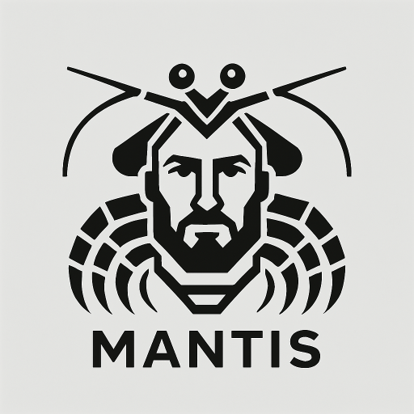

<p align="center">
  <a href="https://mantis.dev.br">
    
  </a>
</p>

<h1 align="center">Ferramentas Utilitárias</h1>

<p align="center">
  <strong>Mantis.dev.br – Sistemas de Visão Computacional</strong><br>
  Autor: Willian Rocha
</p>

<p align="center">
  <a href="LICENSE"></a>
  
</p>

---

## Sobre o repositório

Este repositório é o **cinto de utilitários** da Mantis.dev.br: um conjunto de ferramentas
pequenas, livres e gratuitas para uso geral da comunidade.

Cada ferramenta:

- resolve um problema específico e do dia a dia;
- fica na sua própria pasta, com README, exemplos de uso e o mínimo de dependências;
- pode ser usada pronta ou importada em outros projetos.

As ferramentas podem ser escritas em HTML, CSS, JavaScript, Node, TypeScript, Python, Shell Script
e outras tecnologias, conforme o que fizer mais sentido para cada problema.

## Ferramentas

| Ferramenta | Demonstração | Tecnologia | Descrição |
|---|---|---|---|
| [**Contador de palavras**](word-freak-js/) | [Abrir](https://mantis-dev-br.github.io/ferramentas-utilitarias/word-freak-js/) | JavaScript, HTML, CSS | Conta quantas vezes cada palavra aparece em um texto (ou em uma página web) e mostra o resultado em tabela e gráfico. Também funciona como biblioteca: `WordFrequency.analyze(texto)` devolve a contagem, os grupos de palavras por frequência e os dados prontos para gráficos. |

Cada pasta tem seu próprio README com instruções de uso e de integração.

## Como usar

```bash
git clone https://github.com/mantis-dev-br/ferramentas-utilitarias.git
cd ferramentas-utilitarias
```

Depois, entre na pasta da ferramenta desejada e siga o README dela. As bibliotecas JavaScript também
podem ser usadas direto do CDN, sem clonar o repositório: veja o exemplo no README de cada ferramenta.

## Contribuindo

Sugestões de novas ferramentas, correções e melhorias são bem-vindas: abra uma
[*issue*](https://github.com/mantis-dev-br/ferramentas-utilitarias/issues) ou um *pull request*.

## Licença

Todas as ferramentas são software livre sob a [licença MIT](LICENSE): use, copie, modifique e
distribua, inclusive em projetos comerciais, mantendo o aviso de copyright.

---

<p align="center">
  © 2026 <a href="https://mantis.dev.br">Mantis.dev.br</a> – Sistemas de Visão Computacional
</p>
